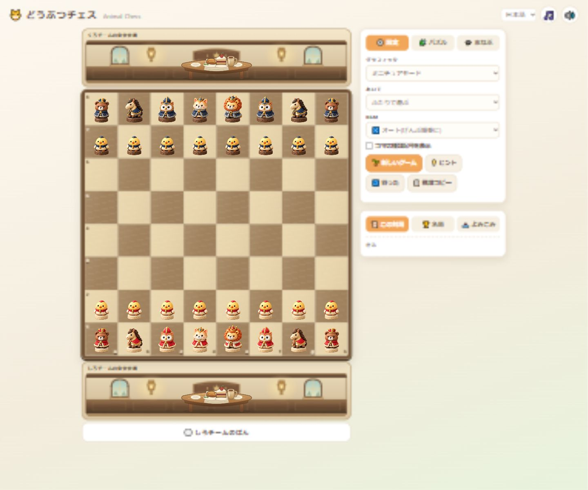

# Graphics modes and miniature scenery / 表示モードとミニチュアの景観

## Behavior / 動作

- `miniature`: the default for new preferences. Detailed figures, maple/walnut board with fine grain and an inset frame, warm timber dining rooms, linen-covered wooden tables, ceramic dishes, food and a carved wooden pony carriage.
- `3d`: the original pixel characters, green/cream board, pixel banquet furniture, food and carriage. Loading the miniature atlas never replaces these canvases.
- `simple`: the existing classic, forest, sea, farm and savanna sets.
- Graphics changes preserve the position, move history, selected square, legal targets, badges and captured guests. The selected mode is saved. Existing `3d` preferences now select the original artwork; choose Miniature to keep using the newer figures.
- Carriage callbacks are invalidated when changing graphics or replacing the position. A previous ride cannot decrement a new ride's pending guests, redraw its venue or issue an obsolete arrival toast.
- Guest positions are proportional to room width, with margins for figures and held food. Narrow screens scroll the entire board/venue group, avoiding the old sticky board covering settings.
- The room is a local SVG; furniture and food are cached Canvas drawings. No external runtime service, new package or image decode is needed for scenery. Original pixel data is unchanged.

日本語: ミニチュアを独立したモードとして追加し、従来の3Dとシンプルも選べるようにした。ミニチュアでは盤・宴会の内装・家具・食事・馬車を木製の小さな世界として揃えた。対局中の切替で局面・棋譜・選択中の駒・捕獲済みの動物を保持する。保存済みの `3d` は元のドット絵を表示するため、新しい駒を引き続き使う場合はミニチュアを選択する。

## Verification / 検証

Passed locally on 2026-10-16:

- `node tools/test_piece_sprites.cjs`: twelve frame bounds, shared decode/cache, atomic decode/dimension/draw failure fallback, miniature-only existing-canvas upgrades, original pixel canvases after decode, both carriage routes. Image/Canvas APIs are mocked for lifecycle checks.
- `node tools/test_graphics_lifecycle.cjs`: obsolete ride callbacks cannot affect the new mode or ride; the current arrival still completes; reduced motion skips rides.
- `node tools/test_learning_async.cjs`: stale CPU/hint/puzzle replies and current puzzle defense.
- `node tools/test_learning_runtime.cjs`: 38 puzzles, 151 continuation states, 254 winning edges.
- `python tools/test_learning.py`: five tests, independent validation of 38 puzzles and 151 states.
- JavaScript syntax and `git diff --check`.
- Codex browser: fresh miniature display; all three graphics modes; all five simple sets with 32 pieces; saved 3D selection after reload; capture and guest arrival; identical move list and 31 remaining pieces across graphics changes; retained selected square and legal targets; miniature promotion and promoted queen; Japanese/English labels; badge toggle.
- Responsive checks at 1440px, 390px and 320px: all initial piece canvases inside their cells, maximum observed square width/height difference 0.015625 CSS px; four promotion images fit at 390px; no horizontal page overflow; a captured guest remains inside the resized room. The previously covered New game button works after removing narrow-screen sticky positioning.
- Captured browser warning/error logs: empty.

日本語: 描画のモード分離、画像の失敗経路、表示切替時の遅延処理、学習機能の回帰検査に合格。ブラウザーで3モード・全5セット、棋譜と選択の保持、捕獲、ミニチュアの昇格、日英切替、保存設定を確認。1440・390・320pxで確認し、狭い画面で設定を覆っていた固定表示を修正した。

These checks cover local browser rendering and mocked lifecycle tests. Physical touch devices, other browser engines, all pixel ratios and reduced-motion OS integration were not tested. No GitHub push or hosted-site deployment is included in this change.

実機のタッチ操作、別のブラウザーエンジン、全画素密度、OSの動きを減らす設定との連動は未検証。今回の変更はローカルまでで、GitHubへのプッシュと公開サイトへの反映は含まない。

[Original 3D / 従来の3D](graphics-modes-2026-10-16/original-3d.jpg) · [320px mobile / スマートフォン幅](graphics-modes-2026-10-16/mobile-320.jpg)
