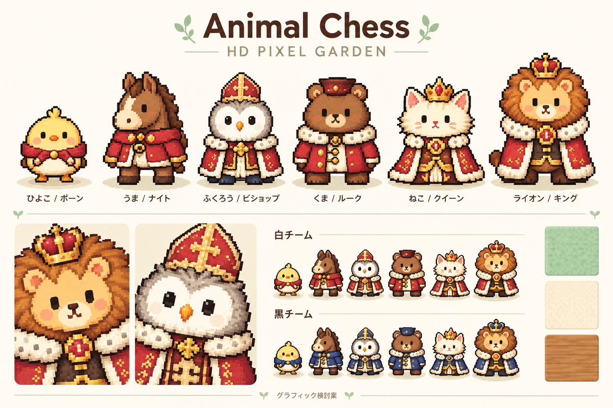
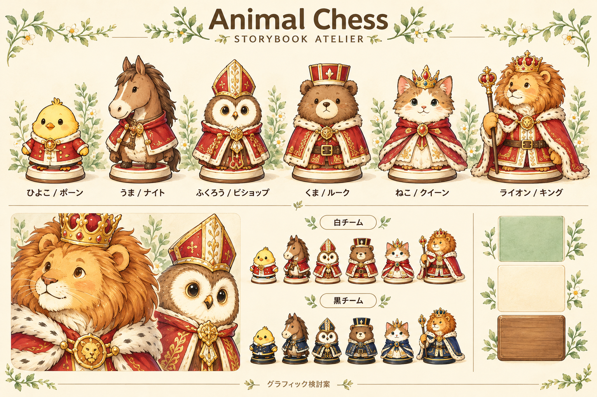
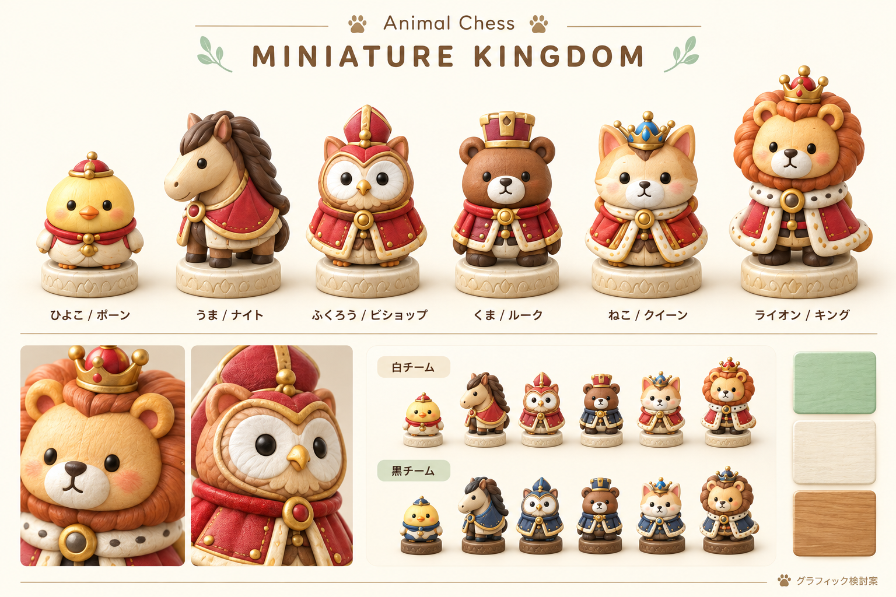

# Animal Chess グラフィック精細化案

2026-10-16追記: MINIATURE KINGDOMを採用し、[精細な駒と正方形のマスを実装](miniature-pieces-2026-10-16.md)した。以下は制作前の比較資料として保存する。

作成日: 2026-10-15。現状の動物の対応、温かいクリーム・緑・木の配色、捕獲後に宴会へ参加する世界観を引き継ぐ。目的は、キャラクターの表情と素材感を豊かにしつつ、学習中の駒の見分けやすさを保つこと。

今回は比較用の画像と制作仕様まで。実装・アセットの組み込み・採用決定は含まない。以下の寸法・容量・性能は提案値で、測定済みの製品仕様ではない。

## 現状から分かったこと

- キャラクターは26×34ピクセル（`js/sprite_data.js:5`）。`js/sprites.js` が色文字列からCanvasを生成し、CSSの `image-rendering: pixelated` で拡大している。
- 現在の「3D」はWebGLの立体モデルではなく、盤面の `scaleY(0.85)`、直立スプライト、接地影による表現。精細化のためにゲーム全体を3Dエンジンへ移す必要はない。
- 表示幅は1マスの64%。駒だけ大きくしても読みやすさには限界があり、帽子・王冠・耳・たてがみの輪郭とチーム識別が重要。
- 学習画面でも上下の宴会場が場所を使い、幅の狭い表示では盤面と解説が離れる。学習中に宴会場を折りたためると、キャラクターを見せる領域と解説領域を両立しやすい。
- 現状CSSに `Yu Gothic UI` の指定が残っている（`css/style.css:25`）。今後のUI変更時に削除し、今回の案・制作仕様ではYu Gothic／Yu Mincho系を使わない。

## 三方向の比較

| 方向 | 精細化で得られるもの | 制作・実装負荷 | 主な注意点 |
| --- | --- | --- | --- |
| HD PIXEL GARDEN / 高精細ドット絵 | 今の親しみやすさを最も保ちやすい。目、羽根、衣装の縫い目が読める | 小〜中。既存の色替え・まばたき方式を活用しやすい | 単なる拡大では増えない情報を描き直す。非整数倍率や縮小で細部が潰れないことを確認 |
| STORYBOOK ATELIER / 絵本風2D | 柔らかい輪郭、紙と布の質感、丁寧な表情。教材との相性がよい | 中。透過画像の読み込みとフレーム管理を追加 | 大きい絵の細密さを小さな駒へ持ち込みすぎない。縁飾りは盤面外に限定 |
| MINIATURE KINGDOM / ミニチュア風2.5D | 木彫り・塗装・衣装の立体感。精細になった印象が強い | 中〜大。統一した視点・光源・影で全素材を制作 | 駒同士の重なりと画像容量。リアルタイム3Dではなく事前レンダリングで軽く運用 |

現行のドット絵を育てるならHD PIXEL GARDENが有力。見た目の変化と精細さを優先するならMINIATURE KINGDOMを検討し、スマートフォンの盤面で識別性を確かめたい。絵本風は教材の挿絵にも展開しやすい。

## HD PIXEL GARDEN

- 原画の目安: 64×84ピクセル。26×34からの自動拡大ではなく、顔・衣装・輪郭を描き直す。小表示用には細部を減らした別版も検討。
- 1素材につき明・中・暗のまとまりを決め、細かなノイズを加えすぎない。肌・羽根の色は共通にし、チーム色だけを衣装と輪郭アクセントで切り替える。
- 通常・まばたきの2フレームから開始。動きは姿勢の読みやすさを崩さない範囲に留める。
- 既存のパレット方式を残す場合も、手入力の文字列だけで大型素材を管理せず、原画PNGとパレット定義から生成できる仕組みを用意する。
- 採用前の重点: 32／48／64 CSS pxで、耳・帽子・王冠が消えないか。DPR 1／2／3で輪郭とピクセル幅が不均一にならないか。

## STORYBOOK ATELIER

- 制作原画は1種類512px程度、配布用は128pxと256pxの透過画像を候補にする。大きな挿絵と盤上の駒には別の細部密度を設定する。
- 輪郭は濃い茶色で統一。紙目は背景側へ抑え、目・口・駒種を示す装飾が埋もれないようにする。
- 白は赤＋アイボリー、黒は紺＋チャコール。台座の明暗でも区別し、色だけに頼らない。
- 2D画像の静止・まばたき・選択を先に揃え、宴会の食事・睡眠へ展開する。
- 採用前の重点: 等倍の小さな駒でライオンとねこが似すぎないか。細い杖や装飾が隣のマスへ侵入しないか。

## MINIATURE KINGDOM

- 立体感は事前に描画した透過PNG/WebPで実現する。盤のマス・座標・操作判定は既存DOMで正確に描く。
- 原画512px程度から配布用128／256pxを作る。6種類×2チーム×通常・まばたきの計24フレームを最小セットとして検討。
- 全種類でカメラ角度、光源、接地面、台座の直径、縮尺を揃える。影は駒と別にして、選択時に濃くなりすぎないよう調整する。
- ポーンは小さく丸い形、ルークは四角い帽子、ビショップは高い帽子、キングはたてがみを含む広い輪郭、クイーンは細い王冠という差を保つ。
- 採用前の重点: 8体並んでも奥のマスが隠れないか。32体と宴会キャラクターを同時表示しても応答が軽いか。
- **この比較図の既知の修正点**: 小表示の白チーム欄で、くまの衣装に紺色が混ざっている。製品用素材では赤・アイボリーへ統一し、色検査の対象にする。比較画像をそのまま素材として切り出さない。

## 共通の制作仕様

### 動物と駒種

| 動物 | 駒 | 識別に使う形 |
| --- | --- | --- |
| ひよこ | ポーン | 小さい丸い輪郭。大きな王冠を付けない |
| うま | ナイト | 長い鼻・耳・たてがみ |
| ふくろう | ビショップ | 丸い目と高い帽子 |
| くま | ルーク | 幅の広い体と四角い帽子 |
| ねこ | クイーン | 尖った耳と細身の王冠 |
| ライオン | キング | 幅広いたてがみと独立した王冠 |

画像の細部とは別に、正確な駒種記号をUIで重ねる。画像生成した記号をそのまま採用しない。白黒表示を消した試験でも種類を見分けられる輪郭を目指す。

### 表示・学習の優先順位

1. キングがチェックされているか、どちらの手番か。
2. 駒種とチーム。
3. 選択元・移動先・直前の手。
4. キャラクターの表情・衣装・宴会の飾り。

駒の横幅はマスの約60〜68%を初期値とし、足元の基準線を共通化する。頭や台座の見かけの中心に合わせて当たり判定を変えず、操作対象は64マスのままにする。盤の右下が明色であること、8×8であること、反転時の座標はコードから保証する。

学習用の矢印・攻撃範囲・合法手は検証済みの局面とチェスのルールから生成する。画像生成には駒の造形と素材表現を担当させ、正しい盤面・棋譜・ルール文を埋め込ませない。最初の画面ラフに盤の段数とキングの利き図の誤りがあったため、最終比較図からは盤面と利き図を除いた。

### フォントと画像読み込み

- 和文はMeiryo、必要ならライセンスを確認してローカル同梱したNoto Sans JP。欧文はSegoe UI等。Yu Gothic／Yu Mincho系は指定しない。
- フォントと画像はローカル配信し、外部への通信がない既存仕様を維持する。
- `Sprites.makePiece` 等の利用側へ画像形式を漏らさず、素材定義にサイズ・足元位置・通常／まばたきフレームを持たせる。
- 画像を事前に読み込み・デコードしてから表示する。移動のたびに画像を作成せず、キャッシュを使う。読み込み失敗時は既存の駒表示に戻せるようにする。
- 色替えを実行時にする場合はマスクを用意する。元絵全体への色フィルターだけで黒チームを作ると、顔・目・装飾まで暗くなるため避ける。

### 性能の目安と受入

- 初期キャラクターセットの圧縮済み転送量は2MB程度を最初の目標とする。これは目標値であり、生成された比較画像のファイルサイズではない。
- 描画コストは実端末で測定。32駒、複数の捕獲駒、馬車、選択表示を同時に動かして確認する。
- 待機中の常時アニメーションを減らし、非表示タブでは停止する。`prefers-reduced-motion` と手動の静止表示を用意する。
- [監査で確認した同期詰み探索](learning-audit-2026-10-15.md)を先に改善する。画像の軽量化だけでは、8〜29秒かかる同期探索による停止は解消しない。
- 390px前後の狭い画面、通常のデスクトップ、拡大表示、盤の反転、日英の説明、種類バッジのON/OFFで実画面を確認する。

## 段階的な実装案

1. 方向を決め、ライオン・ねこ・ひよこの3種類を先に制作。最も重要なキング／クイーンの区別と、数の多いポーンの密度を確かめる。
2. 既存の正しい盤面へ重ねる試作品を作り、小画面と白黒識別を確認する。差し替えに失敗した場合の表示も確認する。
3. 残る3種類と通常・まばたきフレームを制作し、6種類×2チームを揃える。
4. 捕獲後の宴会、馬車、プロモーション選択を同じ素材体系へ合わせる。
5. 重なり、座標、コントラスト、操作応答、動きを減らす設定を確認してから既定表示への採用を決める。

比較画像はbuilt-in `image_gen` で生成。[実際のプロンプト一式](graphics-2026-10-15/prompts.json)を保存した。これは画風の検討資料で、透過・フレーム整列・全サイズでの品質を検証した配布用スプライトではない。
