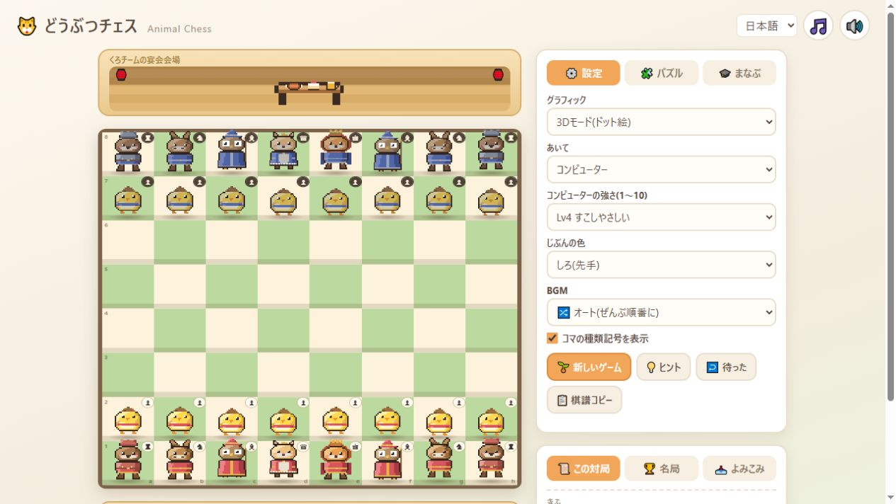
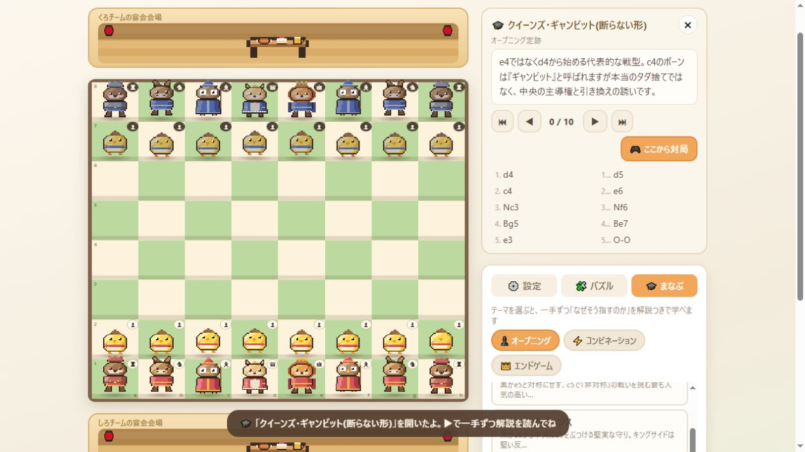
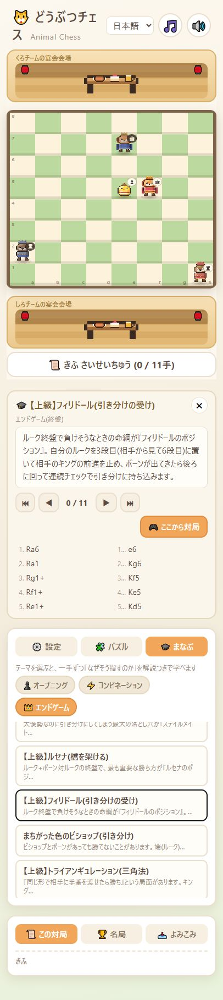
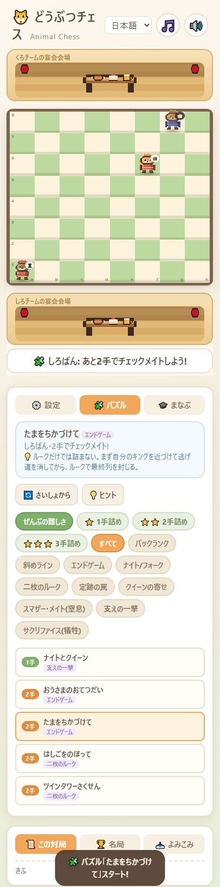

# Animal Chess 学習内容監査

更新: 指摘した教材・実装の修正結果は[2026-10-16の修正記録](learning-fixes-2026-10-16.md)を参照。以下は修正前の監査として保存する。

監査日: 2026-10-15（日本時間）

対象: `a80a6d679b768f486d6d37a884f059226d798990` のローカル実装。

判定: **指し手とパズル解答の整合性は良好。ただし、教材として誤った結論へ誘導する解説・例題があり、修正が必要。**

今回の変更は監査文書、再実行用の検査ツール、証拠データのみ。アプリと既存教材の修正は含まない。

## 検証した範囲

| 対象 | 結果 | この検査で保証しないこと |
| --- | --- | --- |
| 44レッスン・266半手 | 初期局面の構造、全手の合法性、正式なSAN、日英の指し手・ノート数を検査。エラーなし | 解説の真偽、最善応手に対する教材の成立 |
| 名局15局・695半手 | 同じ検査を通過 | 原棋譜との完全一致、日時・会場・逸話の史実認証 |
| パズル38問 | 全問の最短詰み手数と全初手解答が保存データと一致。1手27問、2手7問、3手4問 | 問題名・説明文がその解答を説明していること |
| 実際のJavaScript | 同梱Chessによる961半手の再生、Engine.mateMovesによる38問の再計算が一致。探索後に盤面・履歴が復元されることも確認 | ブラウザーでの全操作、端末ごとの性能 |
| 生成元との一致 | lessons/games の生成関数出力と配布JSが一致 | 検証失敗時の安全な出力、翻訳の意味的正確性 |
| 終盤の勝敗 | Lichessの公開テーブルベースへ19局面を照会し応答を保存 | 照会していない局面の最善性 |
| 説明文 | 44教材の日本語を通読。主要な誤りは英語側も照合。名局は紹介・結論・断定的な手の解説を重点確認 | 名局の全注釈・全翻訳の校閲完了 |
| 実画面 | 初期表示、教材選択、黒番教材、問題選択をCodex内ブラウザーで確認 | 全端末・全画面・スクリーンリーダーでの受入 |

Python 3.14.0 / python-chess 1.11.2 / Node v24.19.0を使用。FENの構造検査は、通常初期配置から到達できることの完全な証明ではない。

## 優先して直す内容

### 1. P1: ルセナの教材は「勝ち切った」という結論が成立しない

場所: `tools/lessons_gen.py:538–554`、`tools/lessons_en.py` の `eg_lucena`。

- 初期局面は白勝ちだが、推奨の `1.Rf4?` は引き分けに落ちる。黒には `1...Ra8+!` がある。
- 教材の最後の `7.e8=Q+` の局面は `4Q3/5k2/8/8/3K4/8/8/8 b - - 0 7`。**`7...Kxe8` が合法で、両キングだけの引き分け**になる。
- 英語の `Kd5` 解説には「d5のキングがf4のルークを守る」ともあるが、キングはf4まで利いていない。守るのは、その後ルークを移したd4。

修正方針: 最善応手でも勝ちを維持できる正しいルセナの配置・手順に置き換える。昇格後まで追い、「橋を作るための待機手」と「ポーンを取らせない距離」の両条件を説明する。

### 2. P1: フィリドールの引き分け手順はルークをただで取られる

場所: `tools/lessons_gen.py:558–572`、英訳 `eg_philidor`。

黒番で始まる `1...Ra6 2.e6 Ra1 3.Kg6 Rg1+` のあと、白は **`4.Rxg1`** で黒ルークを取れる。h1の白ルークがg1を直接攻撃しており、黒キングはe7で取り返せない。教材の最終手 `...Rd1+` に対しても `Rxd1` が可能。最終局面はテーブルベースでも白勝ち。

修正方針: 白ルークが横から取れない配置に改め、フィリドールの防御を維持できる応手を検証する。「チェックが続く」という文章だけで引き分けを確定しない。

### 3. P1: 三角法の勝因を誤って説明している

場所: `tools/lessons_gen.py:615–629`、英訳 `eg_triangulation`。

開始局面は最善同士なら引き分け。`1.Kc4 Kd7 2.Kd4 Ke7 3.Kd5` と配置を戻したあとも、黒の **`3...Kd7` で引き分けを維持**できる。教材の `3...Kf7?` で初めて白勝ちへ変化する。「三角法の1手が勝敗を分けた」という結論は、この盤面には当てはまらない。

修正方針: 本当に手番の移譲が勝敗を変える局面へ置き換える。三角形を描くこととツークツワンクの成立を分けて教える。

### 4. P1: 中間手の教材は余分に得をしていない

場所: `tools/lessons_gen.py:575–585`、英訳 `cb_zwischenzug`。

教材の `...Bxh2+ Kxh2 ...Nxd5 exd5` 後は**双方3ポーン**。一方、単に `...Nxd5 exd5` なら黒はビショップ＋3ポーン、白は4ポーン。教材の手順はh2のポーンと引き換えにビショップを失っており、「黒はポーン1つ得」「順番を変えただけの差」という説明は物量計算として誤り。

修正方針: 比較する2手順の駒数・価値を明示し、中間手を挟むことが実際に得になる例に差し替える。

### 5. P2: パズル「たまをちかづけて」の説明が唯一の解答と逆

場所: `tools/verify_puzzles.py:139–140`、`js/puzzle_en.js` の `Bring Up the King`。

「まず自分のキングを近づけて」と案内するが、初期局面での唯一の2手メイトは **`1.Rh1!`**。正解にキングの移動は含まれない。説明に従ったプレイヤーが不正解になる。

修正方針: この盤面を残すなら「ルークの待機手でキングを動かす」問題に改題・改説する。キング接近を教えるなら盤面を変更する。

### 6. P2: クイーンズ・ギャンビットの日本語名が逆

場所: `tools/lessons_gen.py:90`。

`1.d4 d5 2.c4 e6` は Queen's Gambit **Declined**（拒否形）。タイトルの「断らない形」は逆の意味になる。指し手の説明と英語名はDeclinedになっている。

修正案: 「クイーンズ・ギャンビット・ディクラインド（拒否形）」に統一。[Lichessの定跡データ](https://github.com/lichess-org/chess-openings/blob/master/d.tsv)でも照合できる。

### 7. P2: アンダープロモーションの例は勝利ではなく引き分け

場所: `tools/lessons_gen.py:468–475`。

`e8=N+ Kf7 Nxd6+` の後はキング＋ナイト対キングで、詰みが不可能な引き分け。開始局面では `e8=Q` と `e8=N+` のどちらもテーブルベース上は引き分けで、ナイト昇格だけが勝つ例ではない。「ナイトに昇格した方が一気に勝てる」という紹介にこの例をつなぐと誤解を招く。

修正方針: 「フォークで引き分けを確保する例」と明記するか、クイーン昇格よりナイト昇格が優る局面に変更。`cb_fork` も最後はキング＋ナイト対キングなので、クイーンを取った後の引き分けを補足する。

### 8. 教材形式の改善: 型の実演と強制手順を区別する

| 教材 | 確認した別応手 | 問題点 |
| --- | --- | --- |
| `cb_smother` | `1.Nf7+ Rxf7` | 表示するスマザーメイトの連続手順には進まない。日本語には別応手の注記があるが、英語では省略されている |
| `cb_decoy` | `1.Bb3+ Kh8 2.Nf7+ Rxf7` | フォークするナイトが取られる。注記はあるが、この例を「誘導して勝つ」完成手順として扱うのは不適切 |
| `cb_interference` | `1.c7 Bxd6` | 教材の `...Rxc7` を相手に選んでもらう前提。遮断の意味と、強制的に駒得できることは別 |

この項目は、別応手があるだけで教材が誤りだと断定するものではない。型の実演としては成立し、別応手を明記している日本語もある。確認できたのは、表示手順が強制ではないこと。各別応手の最善性やその後の勝敗は未判定。`cb_windmill` も複数応手を選択した実演なので同じ編集方針で再確認する。なお、調べた `cb_discovered` の `...Qe7` は `Rxe7+` でクイーンを取れるため、戦術が破綻する反証には数えない。

修正方針: 「成立する型を見る実演」「相手がミスした例」「最善応手でも決まる問題」を画面とデータで区別する。実演でも、何を相手が誤ったかをその手に付記する。

### 9. P2: 名局の解説に盤面と一致しない説明

- `reti_tartakower`（`tools/games_gen.py:189,212`）: 「二枚のビショップだけで詰ませる」とあるが、最後はd8のビショップとd1のルークが連携する形。もう一枚の白ビショップはf1に残っている。日英に同種の誤りがある。
- `canal`（同 `:296–297`）: 黒は `10...O-O-O` とクイーンサイドへキャスリングする。日本語のまとめは「キングサイド」と逆。最後のメイトもa6とf4の二枚のビショップの連携で、「一枚だけ」という読み方をさせない説明が必要。

合法な棋譜の再生だけでは、攻めに参加した駒やキャスリングの側の説明は検証できない。

### 10. P2: 黒番開始の棋譜が白番として番号付けされる

場所: `js/app.js:952–960`。`renderMovelist` の `:512` にも同じ前提がある。

フィリドールはFENで黒番開始だが、画面は `1.Ra6 1...e6` と表示する。正しくは `1...Ra6 2.e6`。配列の偶奇から番号・白黒を決め、FENの手番とフルムーブ番号を読んでいない。中間手教材、黒番や途中手数から始まるPGNにも影響する。

修正方針: 開始FENの手番と手数から各手の表記を作る。盤面に「白番／黒番」を常時表示する。

### 11. P2: 定跡・用語の局所的な誤記

| 場所 | 現在 | 修正方向 |
| --- | --- | --- |
| `op_ruylopez` の `4.Ba4`（生成元49行） | 「ピンを保つ」 | d7にポーンがあるためc6のナイトはキングにピンされていない。「圧力を保つ」へ。英語は既にpressure |
| `op_english` の `1.c4`（同274行） | 「d5・e4に圧力」 | c4のポーンの利きはb5とd5。直接の利きと将来の中央構想を分ける。日英とも対象 |
| `op_scandinavian` 紹介（同235行） | 黒が「2手目」で中央のポーンをぶつける | `1...d5` は黒の第1手。「白の初手にすぐ...d5」へ |
| `eg_square` 紹介・まとめ | 四角の内外だけで決まる説明 | どちらの手番か、初期位置のポーンの2歩前進、妨害駒などの前提を補う |
| パズルのバックランク解説 | 黒陣も「一段目」と呼ぶ箇所あり | 「相手の最終段（黒なら8段目）」へ |

## 実装と学習体験の問題

### P1相当: 3手詰めの探索が画面の操作を止めうる

`js/app.js:617,824,851` が `Engine.mateMoves`（`js/engine.js:481`）をUIスレッドで同期実行する。再帰探索に時間上限やメモ化がない。

今回のNodeで初期解答を1回列挙するだけでも、3手問題はそれぞれ **8.609秒、29.224秒、22.613秒、15.564秒**を要した。これは同一端末上のNode計測であり、ブラウザー実測値ではない。コード経路からは、同等の計算中に描画・入力が止まるリスクを確認できる。

修正方針: 全合法応手を含む解答木を生成時に用意するか、Worker上で探索し、局面キャッシュ・中断・操作世代の識別を導入する。初手の `solutions` だけを固定採点に使うと別解や途中分岐を失うため注意。画像精細化より先に対処する価値が高い。

### P2: 検証に失敗しても配布JSを書き換えてから終了する

`lessons_gen.py:703–714`、`games_gen.py:968–979`、`verify_puzzles.py:154–189` は検証結果を確認する前に出力先へ書き込む。失敗項目を除いた不完全なファイルが残りうる。開発メモの「不正な手を混ぜたまま公開しない」と、完全な既存ファイルを守ることは別。

修正方針: 全検査成功を確認してから、同じディレクトリーの一時ファイルへ生成し、置換する。出力先の既存データを破壊しない失敗経路を検証する。

### 学習UIの改善案

1. 入門の順序を「駒の動き→チェックとメイト→特殊ルール→1手問題→戦術→定跡→終盤」として案内。現在は最初から13種類の定跡が並び、前提知識が分からない。
2. 詰みの手数は「自分のあと2回の着手で詰ませる」などと定義する。日本語の将棋式の数え方と混同しやすい。
3. 問題の狙いは段階ヒントにする。現在は解き始める前に狙いが全文見える。
4. 正誤だけでなく、失敗した手への相手の反証手を表示する。教材の分岐と問題の判定を共通の局面データで扱う。
5. アクセシビリティ: 盤のマスはクリックイベント付きdivで、キーボード操作・駒名の読み上げを備えていない（`app.js:99–114`）。縮小画面では座標とバッジが特に小さい。常時揺れる駒には動きを減らす設定も必要。スクリーンリーダーの実機検証は未実施。

## 実画面の記録

1. 初期画面。動物の対応付けと温かい配色は一貫している。一方、座標と小さな種類記号の読みやすさには改善余地がある。



2. 定跡教材。解説と盤面を同時に確認できる構成。タイトルに「断らない形」が表示されることを確認。



3. 黒番教材。幅の狭い表示では学習パネルが盤面と宴会場の下に位置する。黒番の手を白番の列に置いてしまう表示も記録。



4. 問題選択。「まずキングを近づけて」と案内する状態を記録。正解初手の照合は別途、両ルール実装で実施。



画面キャプチャ中に利用可能なブラウザーの幅が変わったため、固定ビューポート同士の比較ではない。上記は各操作時点の実画面であり、全ブレークポイントの検証とはしない。

## 再現と証拠

```powershell
python tools/audit_learning.py --output docs/audit-2026-10-15/validation.json
node tools/audit_runtime.cjs --puzzles
```

- [構造と解答の検証](audit-2026-10-15/validation.json)
- [実際のJSソルバーの計測](audit-2026-10-15/runtime.jsonl)
- [反証手とその盤面・駒数](audit-2026-10-15/counterexamples.json)
- [初期局面・初手後のテーブルベース応答](audit-2026-10-15/tablebase.json)
- [手順途中・最終局面の応答](audit-2026-10-15/tablebase-lines.json)

テーブルベースの `response.category` は**その局面の手番側**の勝敗。`moves[].category` は**その手を指した後の手番側**の勝敗なので、符号を逆に読まない。[Lichess API仕様](https://github.com/lichess-org/lila-tablebase#http-api)。応答中に照会URLとFENを保存した。

ルールの基準は[FIDE Laws of Chess](https://handbook.fide.com/chapter/E012023) の駒の利き（第3条）、メイト・ステイルメイト・詰み不可能局面（第5条）。棋譜の合法性と史実の正しさは分けて扱い、名局の全15局の出典照合は今後の編集作業に残す。

## 修正の進め方

1. ルセナ、フィリドール、中間手、三角法を正しい教材へ置換し、日英を同時修正する。
2. パズル案内、定跡名、名局の駒・側の説明、黒番開始の棋譜表示を修正する。
3. 教材に `goal`、前提、主変化、反証・別応手、最終判定、出典を持たせ、説明する主張自体を検査できるようにする。
4. 同期探索を改善してから、[グラフィック案](graphics-proposals-2026-10-15.md)の駒を少数制作し、盤面上の見分けやすさを確認する。
