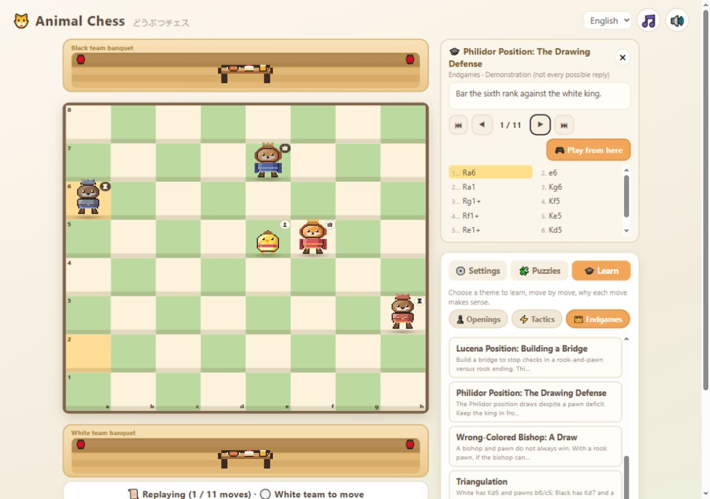

# Animal Chess 学習内容の修正記録

実施日: 2026-10-16（日本時間）。[2026-10-15の監査](learning-audit-2026-10-15.md)で確認した教材の誤りと実装上の問題を修正した。

## 教材の修正

| 監査項目 | 修正内容と確認方法 |
| --- | --- |
| 1 ルセナ | 黒キングをh7へ離した配置に変更。ポーンを守るKd6を経て、c4に橋を架ける手順へ置換。開始から昇格まで16局面が白勝ち。勝勢とチェックメイトを区別した。 |
| 2 フィリドール | 白ルークをh3へ移し、後方からチェックする黒ルークを横から取れない配置へ変更。全12局面が引き分け。最終図でも対局は続くと明記した。 |
| 3 三角法 | 白Kd5・Pb6/c5、黒Kd7・Pb7の配置を採用。5半手後に同じ駒配置で黒番となる。全16局面が白勝ちで、初手c6+は引き分けに落ちることも確認した。 |
| 4 中間手 | Ng4がBh2を守る配置へ置換。Bxh2+への全合法応手Kh1/Kf1で、直ちにRxd8とする場合よりポーンを1枚多く取れることを駒数で検査した。 |
| 5 パズル案内 | 「たまをちかづけて」を「ルークのまちて」に改題し、正解Rh1に合う説明へ変更。問題順序と局面を維持し、保存済みの達成番号を変えていない。 |
| 6 定跡名 | クイーンズ・ギャンビットの「断らない形」を「ディクラインド（拒否形）」へ訂正。 |
| 7 昇格・フォーク | キング＋ナイト対キングは引き分けと明記。アンダープロモーション例ではクイーン昇格も引き分けであり、ナイトだけが勝つ例ではないと説明した。 |
| 8 型の実演 | スマザーメイト、デコイ、遮断、風車で、選択した応手・相手の誤り・別応手を日英に明記。教材画面にも全応手を網羅する手順ではないことを表示した。 |
| 9 名局解説 | レティ対タルタコワーのビショップとルークの連携、カナルのクイーンサイドへのキャスリングと2枚のビショップを訂正。ルガールの連携はナイトとビショップと明示した。 |
| 10 黒番の棋譜 | 開始FENの手番とフルムーブ番号から表示番号を計算。再生中も手番を表示する。 |
| 11 用語 | ルイ・ロペスの圧力とピン、c4の利き、スカンジナビアンの初手、四角形の法則の前提、バックランクの段数を訂正。 |

3つの終盤教材の計44局面は、[保存したテーブルベース応答](learning-fixes-tablebase.json)と現在の教材を全局面で照合した。勝敗は手番側から記録されるため、黒番のlossは白勝ちとして扱う。これは掲載手順の検証であり、すべての別応手を教材に収録したという意味ではない。

## 実装と操作

- 38パズルの全正解と全合法な防御を生成時に展開し、151継続局面・254正解手を収録。ブラウザーの採点とヒントは保存データを参照し、時間のかかる同期詰み探索を呼ばなくした。データ不足時はエラーを案内し、不正解と扱わない。
- CPU、通常ヒント、パズルの遅延応手に局面とゲームの同一性チェックを追加。ゲームを切り替えた後の古い応答を破棄する。
- ヒントは1回目で狙い、2回目で移動元と移動先を提示。詰みの手数は自分の着手回数で、相手の応手を含まないと説明する。
- 盤のマスをボタンにし、矢印キーで移動、Enter／Spaceで選択、Escapeで選択解除できるようにした。座標・駒名・合法移動先の読み上げ用ラベルを付与した。
- 座標と駒種バッジを拡大。OSの動きを減らす設定に対応。Yu Gothic系フォント指定を除いた。
- 教材・棋譜・パズル生成は全件検証後に一時ファイルから置換する。不正データや置換失敗時に既存ファイルが保持されることを検査した。

## 検証結果

| 検査 | 結果 |
| --- | --- |
| Pythonの教材監査 | 44教材271半手＋15棋譜695半手。合法性・SAN・日英データ・生成元との整合性を確認。issuesは空。 |
| 実際のJavaScriptルール実装 | 966半手の再生でエラーなし。 |
| パズル回帰検査 | 独立したPython探索で38問の全151継続局面を照合。JavaScriptでも254正解手と全防御分岐、盤面・履歴の保持を確認。 |
| 遅延処理の回帰検査 | 同じFENの別ゲームへのCPU応答、古いヒント、新しいヒントの待機状態、古いパズル応手、不正解と正常な応手を確認。 |
| 生成失敗の回帰検査 | 不正な棋譜、誤った詰み手数、ファイル置換失敗で既存データを保持。Python全5テスト成功。 |
| 構文・差分 | 変更したJavaScriptの構文検査とgit diff --checkを通過。 |
| ブラウザー | Codex内ブラウザーで日英切替、フィリドールの1…Ra6／2.e6、段階ヒント、矢印・Enter・SpaceによるRh1→…Kf8→Rh8#を確認。幅1280と390で横方向のはみ出しなし。 |

ブラウザー確認後の最終編集は名局とバックランクの文章のみ。スクリーンリーダー、実機タッチ、全ブラウザー、動きを減らす設定の実画面は未検証。Nodeでの参照時間をブラウザーの性能保証として扱っていない。



[幅390でのパズル完了画面](learning-fixes-2026-10-16/puzzle-mobile.png)には正解演出と切替直前の英語通知が残っている。

## 再実行

```powershell
python tools/lessons_gen.py
python tools/games_gen.py
python tools/verify_puzzles.py
python tools/audit_learning.py --output docs/learning-fixes-validation.json
python tools/test_learning.py
node tools/test_learning_runtime.cjs
node tools/test_learning_async.cjs
node tools/audit_runtime.cjs
git diff --check
```

[機械検証結果](learning-fixes-validation.json)。通常の回帰検査は保存済みテーブルベース応答を使い、ネット接続を必要としない。公開APIから証拠を更新する場合のみ `python tools/probe_endgames.py` を実行する。この更新用ツールの現行版は構文確認済みで、今回の最終検査ではネットワーク再取得を行っていない。

## 今後の拡張

監査で提案した入門カリキュラムの再編、誤答に対する反証手の表示、教材への構造化された出典・分岐情報の追加は、今回の不具合修正には含めていない。名局15局すべての史実・原棋譜照合と全注釈の校閲も未完了。

精細なグラフィックの方向性は[作成済みの3案](graphics-proposals-2026-10-15.md)を参照。今回の変更は読みやすさと操作性の改善までで、駒画像の置き換えは行っていない。
