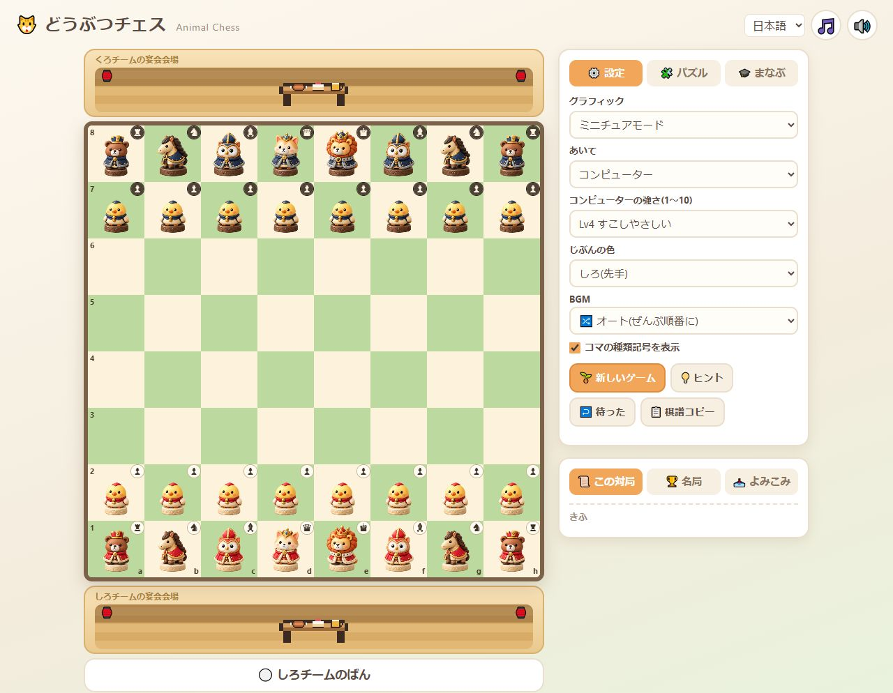

# Detailed miniature pieces / 精細なミニチュア駒

Implemented on 2026-10-16. The Miniature Kingdom direction is now the default detailed renderer, replacing the old pixel characters in the existing `3d` setting. Saved preferences remain compatible.

2026-10-16に実装。Miniature Kingdom案を採用し、既存の `3d` 設定の駒を精細な画像へ置き換えた。保存済みの設定との互換性は維持している。

## Assets and geometry / 画像と配置

- Six animal roles, each in red/ivory and navy/walnut teams: twelve transparent figures in one 1.64 MB PNG. / 6種類×白黒の透過画像を1枚のPNG（約1.64MB）に収録。
- Source: [atlas](../assets/pieces/miniature-atlas.png), [production prompt](../assets/pieces/prompt.txt), [asset notes](../assets/pieces/README.md). Generated with built-in `image_gen`; original alpha retained. / 組み込みimage_genで生成し、透過情報を保持。
- Removed vertical board compression and inverse piece scaling. All 64 cells now have equal width and height, subject only to subpixel rounding. / 盤の縦圧縮と駒の逆補正を除き、64マスを正方形に統一。
- Each source figure is fitted proportionally onto a cached 256-pixel square canvas, with a shared baseline and role-specific height. The board container is inset 2%; selection rises by only 2% within that space. / 縦横比を保って256角へ描画。足元と種類ごとの高さを揃え、マス内の余白に選択時の移動分も確保。
- The same detailed characters appear in promotion choices, banquet guests, and carriage passengers. The carriage and furniture retain their pixel artwork. / 昇格候補、宴会の動物、馬車の乗客にも同じ精細画像を使用。馬車本体と家具は既存のドット絵。
- No constant board bobbing. Detailed characters are static figurines; no closed-eye frames are supplied. / 盤上の常時揺れを停止。精細な駒は静止画で、まばたき用画像は未制作。
- Updated mode labels in Japanese and English; corrected English animal names in detailed mode. Narrow headers now use two rows. / 日英のモード名と英語の動物名を修正。狭い画面のヘッダーは2行に整理。

## Loading and fallback / 読み込みと代替表示

The atlas is decoded once, and all twelve frames are prepared before switching. Decode failure, unexpected dimensions, or frame rendering failure preserves the complete old pixel set. Existing canvases are upgraded without resetting game state, keyboard focus, or selection. All assets are served locally with the app; no external service is contacted at runtime.

一度だけ画像をデコードし、12駒すべての準備後に切り替える。読み込み失敗、寸法不一致、途中の描画失敗では従来のドット絵を保持する。切り替え時に対局・フォーカス・選択を初期化しない。実行時に外部サービスへの通信は行わない。

## Verification / 検証

- `node tools/test_piece_sprites.cjs`: passed. Checks all twelve frame bounds, a single shared decode, cache reuse, existing-canvas upgrade, three failure paths, and carriage drawing calls. Canvas/image APIs are mocked for lifecycle testing, so this is separate from visual acceptance. / 12駒の範囲、共有デコード、キャッシュ、既存Canvasの更新、3種類の失敗経路、馬車の描画呼出しを確認。APIを模擬する検査であり実画面の代用ではない。
- `node tools/test_learning_runtime.cjs`: passed for 38 puzzles, 151 continuation positions, 254 winning edges. / 38パズル・151局面・254正解手を確認。
- `node tools/test_learning_async.cjs`: passed. / 遅延応答の回帰検査に合格。
- Syntax checks for changed JavaScript and `git diff --check`: passed. / 変更JSの構文と差分検査に合格。
- Codex in-app browser: initial 32 pieces, movement, capture and banquet arrival, promotion selection and promoted queen, black orientation, selected piece, badges on/off, simple/detailed switch, Japanese/English switch. No app warnings/errors observed in captured console logs. / 実画面で初期32駒、移動、捕獲と宴会への到着、昇格候補と昇格後のクイーン、黒側からの表示、選択、バッジ切替、表示モード切替、日英切替を確認。取得したコンソールログにアプリの警告・エラーなし。
- Viewport checks: desktop and 1280px, mobile 390px and 320px. All 32 character canvases remained within their cells; maximum observed width/height difference was 0.015625 CSS px. Selected and reversed positions also remained contained. All four promotion images fit inside their buttons at 390px. No horizontal page overflow at the tested narrow widths. / 各幅で32駒がマス内に収まり、縦横差は最大0.015625 CSS px。選択・反転時も収まり、390pxでは昇格画像4枚がボタン内に収まる。狭い幅で横方向のはみ出しなし。

[Mobile / スマートフォン幅](miniature-2026-10-16/mobile.png) · [Reversed board / 反転した盤](miniature-2026-10-16/reversed.png) · [Promotion / 昇格選択](miniature-2026-10-16/promotion.png)

Hardware touch devices, other browser engines, and all device-pixel ratios were not tested. This change is committed locally; it does not publish the hosted website.

タッチ端末の実機、他のブラウザーエンジン、すべての画素密度では未検証。この変更はローカルのコミットまでで、公開サイトへの反映は含まない。
